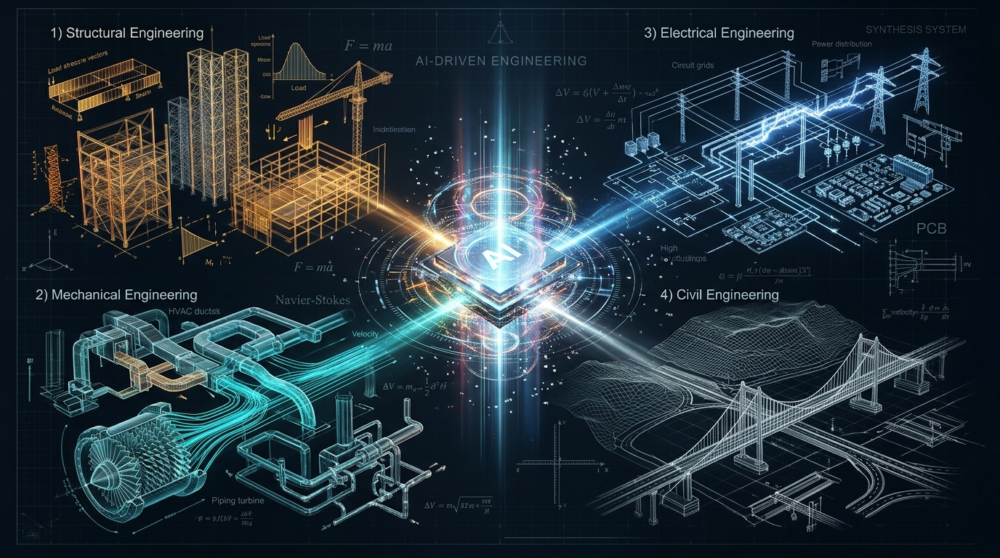
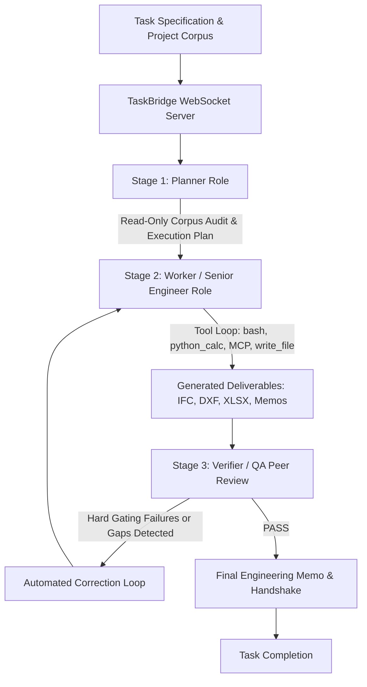

# Gemini Physical-Engineering Agent Harness



An autonomous agent harness engineered to solve real-world, long-horizon physical engineering challenges on the **[Google - Agent Harness on Physical-Engineering's Last Exam (PLE)](https://www.kaggle.com/competitions/physical-engineerings-last-exam/overview)** benchmark.

---

## 1. System Architecture

The harness implements a **Plan-Work-Verify** multi-role architecture tailored for the four core engineering domains (**Structural, Civil, Electrical, and Mechanical**).



### Key Pillars
1. **Corpus Reconnaissance & Planning**: Automatically surveys messy project directories (~61 files per task), categorizes discipline (Structural, Civil, Electrical, Mechanical), extracts constraints, and formulates closed-form calculation strategies.
2. **Deterministic Calculation Engine (`python_calc`)**: Employs sandboxed Python execution for engineering equations (AISC member capacity, NEC ampacity/voltage drop, Darcy-Weisbach head loss, Rational Method runoff), avoiding LLM math hallucination.
3. **Hard Feasibility Gating ($G=1$)**: In PLE, violating any hard safety constraint caps deliverable item scores at `0.40`. The Verifier audits safety margins, load envelopes, and file integrity before finalizing.
4. **Full MCP Interoperability**: Dynamically detects task-provided Model Context Protocol servers (CAD tools, document viewers, calculation engines) and binds them either as direct function calls or via catalog search (`mcp_find` / `mcp_call`).
5. **Context Compaction & Token Budgeting**: Tracks token consumption and generates dense state memos when approaching limits, preventing prompt-length errors.
6. **Time Budgeting & Graceful Wrap-up**: Dynamically fractions remaining task time (`PLAN_SHARE = 0.12`, `WORK_SHARE = 0.65`, `CHECK_SHARE = 0.23`). Traps `cancel` signals and preserves the highest-quality `final_message` for grading.

---

## 2. Directory Structure

```
├── submission.yaml      # Competition submission descriptor (model_api, install, serve commands)
├── serve.py             # Main WebSocket server implementing PLE Serve Protocol v1
├── taskbridge.py        # Official protocol plumbing, Session management, and MCP Relay
├── tools.py             # Built-in and MCP tool specifications & clipping utilities
├── prompts.py           # Domain-tuned engineering prompt templates (Structural, Civil, Electrical, Mechanical)
├── install.sh           # Container setup script for Linux environments
├── requirements.txt     # Pinned Python dependencies (websockets, openai, pyyaml)
├── .gitignore           # Excludes local environments, credentials, and non-deterministic files
├── .gitattributes      # Enforces LF line endings and byte-for-byte git tracking
└── README.md            # System documentation and execution guide
```

---

## 3. Local Verification & Testing

### Prerequisites
- **Docker Desktop** (running)
- **Python 3.12** & **`uv`**
- **Git**
- **Hugging Face Token** (with access to `google/physical-engineerings-last-exam`)
- **Google Cloud SDK (`gcloud`)** with Vertex AI enabled

### Step-by-Step Setup

```bash
# 1. Install Harbor with websockets
uv tool install harbor==0.20.0 --with websockets
export HF_TOKEN="<your_huggingface_read_token>"

# 2. Clone the official PLE benchmark kit
git clone https://github.com/google-research/ple.git
cd ple

# 3. Start the local Model Proxy backed by Vertex AI
gcloud auth application-default login
export VERTEXAI_PROJECT="<your_gcp_project_id>"
export MODEL_PROXY_KEY=$(openssl rand -hex 24)
kit/model_proxy/start.sh &
export MODEL_PROXY_URL="http://localhost:4000"

# 4. Smoke-test and validate this harness
uv run python -m kit check "path/to/gemini-engineering-harness"

# 5. Run the 29 public development tasks and generate artifacts
uv run python eval/run.py "path/to/gemini-engineering-harness"
```

---

## 4. Preparing the Competition Submission

1. Once `eval/run.py` completes, it generates the `artifacts/` folder containing deliverables and `manifest.json`.
2. Review the artifacts:
   ```bash
   uv run python -m kit artifacts "path/to/gemini-engineering-harness"
   ```
3. Commit the entire repository including the harness and `artifacts/`:
   ```bash
   git add -A
   git commit -m "PLE Dev Set Evaluation Artifacts"
   ```
4. Verify readiness:
   ```bash
   uv run python -m kit check "path/to/gemini-engineering-harness"
   # Output should confirm: ready to submit
   ```
5. Submit the designated GitHub commit hash on Kaggle / ple-bench.com.

