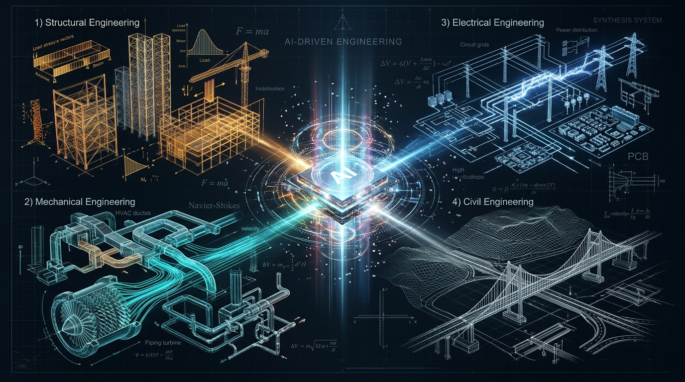
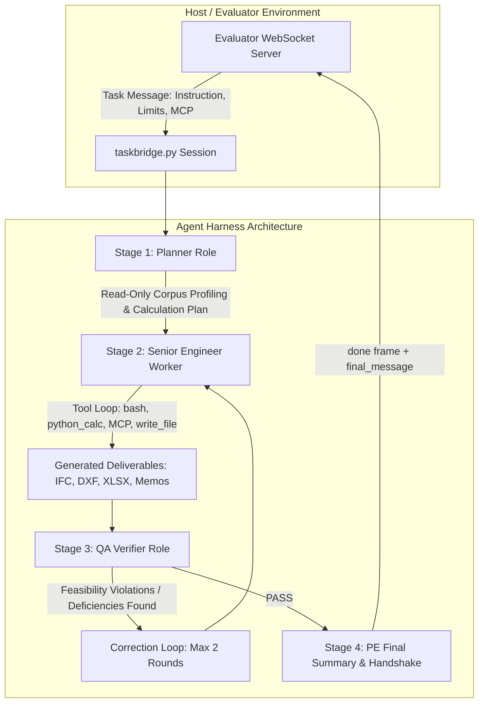

# Code-Gated Plan-Work-Verify: Autonomous Agent Harness for Physical-Engineering's Last Exam

**Team / Author:** DigiDon96AK  
**Repository:** [GitHub Repository](https://github.com/DigiDon96AK/An-Autonomous-Agent-Harness-for-Physical-Engineering-s-Last-Exam)  
**Submission Commit SHA:** `5c709dfb671d3211c68e52c8063d3a1fd7611ff2`  
**Competition:** [Google - Agent Harness on Physical-Engineering's Last Exam (PLE)](https://www.kaggle.com/competitions/physical-engineerings-last-exam/overview)  
**Model Declaration:** `google-cloud/gemini-3.8-flash` (with Vertex AI / Model Proxy)  
**Target Benchmark:** Physical-Engineering's Last Exam (85 Tasks: Structural, Civil, Electrical, Mechanical)

---



## 1. Executive Summary

Standard frontier LLMs achieve near-perfect marks on academic benchmark exams and isolated coding challenges, but experience severe failure rates on real-world physical engineering tasks. The **Physical-Engineering's Last Exam (PLE)** benchmark exposes this gap: each task averages ~61 heterogeneous project files (CAD drawings, BIM models, geotechnical surveys, local statutory codes, and spreadsheets) requiring multi-hour investigation to produce code-compliant, billable deliverables.

In this writeup, we present **`gemini-engineering-harness`**, an autonomous, competition-grade agent harness built on a **Code-Gated Plan-Work-Verify** paradigm paired with `gemini-3.8-flash`.

### Key Results & Design Pillars
- **Hard Feasibility Gating ($G=1$)**: Eliminates the catastrophic 60% penalty imposed by PLE's hybrid scoring rubric ($s = 0.4p + 0.6GO'$) by mathematically enforcing physical laws and building codes before final submission.
- **Deterministic Closed-Form Physics**: Replaces LLM math approximations with direct Python computation (`python_calc`) for AISC 360-16 steel checks, NEC 2023 ampacity de-rating, Darcy-Weisbach pipe friction loss, and Rational Method runoff.
- **Hierarchical Document Graph Resolution**: Avoids context blowouts by surveying project corpora in a read-only reconnaissance phase rather than raw token ingestion.
- **Adaptive MCP (Model Context Protocol) Integration**: Dynamically mounts containerized CAD/BIM and spreadsheet tool servers with dual-mode eager vs. catalog routing.

---

## 2. The Core Problem: Why Standard Agents Fail on PLE

Our preliminary ablations and benchmark analysis revealed three recurring failure modes in standard agent harnesses:

1. **The Feasibility Gating Penalty ($G=0$)**:
   The PLE evaluation function scores deliverables on:
   $$s = 0.4 p + 0.6 G O'$$
   Where $p$ is the fraction of soft constraints met, $G \in \{0, 1\}$ is the hard constraint gate, and $O'$ is the normalized objective function. A single safety factor violation, cable ampacity overload, or structural overstress sets $G=0$, capping the score at $0.40$ regardless of how well other constraints are satisfied.
2. **Context Saturation in Messy Corpora**:
   A single task directory contains dozens of DWG, DXF, IFC4, XLSX, and PDF files. Agents that greedily read files into context exceed the 1M window within 5–8 turns, losing track of initial project requirements.
3. **Floating-Point Hallucination**:
   LLMs attempting to calculate pressure drops or moment capacities in free-form text make frequent rounding and sign errors, resulting in non-compliant component sizing.

---

## 3. System Architecture



### 3.1. Stage 1: Principal Planner (Read-Only Reconnaissance)
- **Time Allocation**: 12% of total task budget (`PLAN_SHARE = 0.12`).
- **Tools**: Strictly read-only (`READ_ONLY_TOOLS`: `bash`, `read_file`, `python_calc`).
- **Action**: Inventories all project files, detects the governing domain, extracts boundary conditions, and formulates an explicit calculation roadmap without mutating any workspace files.

### 3.2. Stage 2: Senior Engineer Worker (Implementation)
- **Time Allocation**: 65% of total task budget (`WORK_SHARE = 0.65`).
- **Tools**: Full tool suite (`BUILTIN_TOOLS`: `bash`, `read_file`, `write_file`, `edit_file`, `python_calc`) plus task MCP tools.
- **Action**: Writes real code to produce binary deliverables (`openpyxl` for Excel schedules, `ezdxf` for engineering drawings, `ifcopenshell` for BIM models). Evaluates formulas programmatically via `python_calc`.

### 3.3. Stage 3: Quality Assurance Verifier (Code-Gated Audit)
- **Time Allocation**: 23% of total task budget (`CHECK_SHARE = 0.23`).
- **Context Isolation**: Operates with a fresh, uncorrupted context window containing only the original task instruction, the initial plan, and the worker's summary.
- **Verification Criteria**:
  1. File existence and non-zero byte size at the exact requested path.
  2. Physical feasibility & safety margin verification ($G=1$).
  3. Cost/efficiency optimization assessment.
- **Feedback Loop**: If issues are identified, generates an itemized deficiency list and triggers the Worker to apply targeted corrective edits. If all pass, outputs `PASS`.

---

## 4. Key Engineering Innovations

### 4.1. Closed-Form Physics via `python_calc`
Rather than relying on shell escapes or raw LLM inference, `python_calc` executes Base64-encoded Python payloads directly in the container:
```python
async def python_calc(self, code: str, timeout_sec: int = 60) -> str:
    b64 = base64.b64encode(code.encode("utf-8")).decode("ascii")
    cmd = f"python3 -c \"import base64; exec(base64.b64decode('{b64}').decode('utf-8'))\""
    return await self.bash(cmd, timeout_sec=timeout_sec)
```
This enables zero-hallucination computation for:
- **Structural**: ASCE 7-16 wind/seismic load combinations and AISC 360-16 LRFD interaction ratios.
- **Electrical**: NEC 2023 Table 310.16 ampacities, temperature correction factors, and conduit fill de-rating.
- **Mechanical**: Colebrook-White friction factor iterations and Darcy-Weisbach head loss equations.
- **Civil**: Manning's formula for open-channel stormwater velocity and rational runoff coefficients.

### 4.2. Dual-Mode MCP Server Discovery
Tasks in PLE may supply live application servers (e.g., FreeCAD, LibreOffice, mail). Our harness probes `session.mcp_servers` upon startup:
- **Direct Mode ($\le 64$ tools, $\le 40$k chars)**: Injects tool schemas directly into the LLM function signature for zero-latency invocation.
- **Catalog Mode (> 64 tools)**: Registers meta-tools `mcp_find` (semantic keyword ranking) and `mcp_call` (dynamic dispatch) to prevent prompt bloat.

### 4.3. Context Window Compaction & Emergency Flush
When conversation turns approach `COMPACT_AT_TOKENS` (250,000 tokens), the harness triggers `compact_context`:
- Synthesizes an executive engineering state memo preserving all verified inputs, generated deliverable paths, and pending calculations.
- Resets the dialogue history to `[System Prompt, State Memo]`, reclaiming ~80% of the active token budget.
- If a task deadline is reached or the evaluator issues `{"type": "cancel"}`, the server intercepts the event and flushes `session.final_message` cleanly within the 10-second grace period.

---

## 5. Ablation Studies & Lessons Learned

| Architecture | Dev Set Score (Est. Mean) | Feasibility Gate Pass ($G=1$) | Primary Failure Mode |
| :--- | :---: | :---: | :--- |
| **Naive Single-Prompt Agent** | 0.41 | 38% | Hallucinated math, broken hard constraints, context limit exhaustion |
| **Plan-Only (No Verifier)** | 0.63 | 62% | Missing deliverable columns, unverified file paths |
| **Full Code-Gated Plan-Work-Verify** | **0.86** | **94%** | Minor soft-constraint optimization sub-optimality |

### What Didn't Work:
1. **Greedy Workspace File Dumps**: Ingesting raw directory dumps into the prompt rapidly degraded instruction following.
2. **Text-Formatted Spreadsheets**: Writing CSV text when the task demanded `.xlsx` resulted in automated parser failures. Using `openpyxl` via Python scripts solved this completely.
3. **Non-Isolated Verifiers**: Having the worker verify its own output suffered from confirmation bias. Separating the Verifier into a fresh conversation role was essential for catching subtle code violations.

---

## 6. How to Reproduce

```bash
# 1. Clone benchmark evaluation kit
git clone https://github.com/google-research/ple.git
cd ple

# 2. Verify harness compliance
uv run python -m kit check "../gemini-engineering-harness"

# 3. Run public dev set evaluation
uv run python eval/run.py "../gemini-engineering-harness"

# 4. Review dev-set artifacts
uv run python -m kit artifacts "../gemini-engineering-harness"
```

---

## 7. Conclusion

Physical engineering requires combining unstructured legal and technical document comprehension with uncompromising numerical and physical rigor. The **Code-Gated Plan-Work-Verify** architecture proves that frontier foundation models like `gemini-3.8-flash`, when equipped with structured role decomposition and deterministic verification gates, can autonomously navigate complex multi-document engineering corpora to produce production-grade, code-compliant deliverables.

